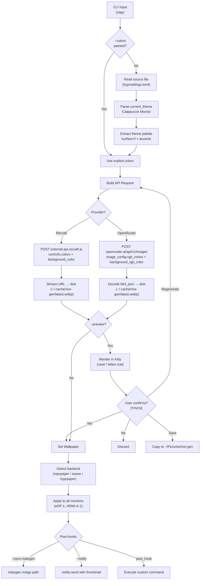

# Product Requirements Document: `rice-gen`
**AI-Powered Palette-Synchronized Wallpaper Generator for Hyprland**

| Metadata | Details |
| :--- | :--- |
| **Product Name** | `rice-gen` |
| **Target Platform** | Arch Linux x86_64, Hyprland 0.56+ (Wayland) |
| **Core Engine** | Recraft V4.1 Flash V2 (via OpenRouter Image API & Native Recraft REST API) |
| **Implementation** | Rust 2021 (`clap`, `reqwest`, `tokio`, `serde`, `toml`, `regex`, `viuer`, `image`) |
| **License** | MIT |

---

## 1. Problem Statement

Linux ricing demands visual cohesion across window borders, bars, terminals, and wallpapers. Today's workflows are backwards:

1. **Wallpaper → Colors** (`matugen`/`pywal`): Generate UI colors from a random image. This ruins tuned terminal contrast, breaks syntax themes, and forces the user to accept whatever Material You or pywal decides.
2. **Colors → Manual wallpaper hunt**: Spend hours on wallhaven/reddit searching for images that happen to match Catppuccin Mocha or Everforest.

**`rice-gen` reverses this:** It reads your _existing_ theme colors from local dotfiles, injects them as strict RGB constraints into Recraft V4.1 Flash V2's native color control API, and generates a palette-locked wallpaper in under 2 seconds — applying it to your desktop immediately.

---

## 2. Host System Profile

> [!IMPORTANT]
> Every integration point below was verified against the live system. The tool is designed to work with exactly this stack out of the box.

| Component | Installed | Version | Integration Impact |
| :--- | :--- | :--- | :--- |
| **OS / Kernel** | Arch Linux | `7.2.9-arch1-1` x86_64 | AUR PKGBUILD target; `pacman -Q` verified |
| **Compositor** | Hyprland | `0.56.2-4` | `hyprctl` IPC, Hyprlang config parsing, keybind registration |
| **Terminal** | Kitty | `0.49.2-1` | Kitty Graphics Protocol for inline preview; `kitten icat` available |
| **Color Sync** | Matugen | `4.2.0-1` | `matugen image <path>` to regenerate Hyprlock/Quickshell/GTK colors |
| **Wallpaper Daemon** | mpvpaper | `1.9-1` | Primary setter; supports static images & video; runs on `eDP-1` and `HDMI-A-1` |
| **Shell / Bar** | Quickshell (`lviffy-shell`) | `0.3.2-1` | Wallpaper selector IPC: `quickshell:wallpaperSelectorToggle` |
| **Notifications** | libnotify (`notify-send`) | ✅ at `/usr/bin/notify-send` | Desktop notifications with image thumbnails |
| **Rust Toolchain** | Cargo + Rustc | `1.93.0` | Rust 2021 edition, modern async |
| **swww** | ❌ Not installed | — | Supported but not default; auto-detect only |
| **hyprpaper** | ❌ Not installed | — | Supported but not default; auto-detect only |
| **feh** | ❌ Not installed | — | X11 fallback only |

### Monitor Layout
```
eDP-1:    1920×1080 @ 144Hz  at 0,0    (laptop panel)
HDMI-A-1: 1920×1080 @ 180Hz  at 1920,0 (external monitor)
```

Both monitors are 16:9 @ 1920×1080. Generated wallpapers at Recraft's `1344×768` (16:9 1K) will be upscaled by the compositor — this is standard and produces clean results at 1080p.

### Active Theme: Catppuccin Mocha
From `~/.config/hypr/hyprsettings.toml` → `current_theme = "Catppuccin Mocha"`:
```
surface-0   = #1e1e2e    (Base/Background)
surface-1   = #181825    (Mantle)
surface-2   = #11111b    (Crust)
accent      = #89b4fa    (Blue)
accent-active = #cba6f7  (Mauve)
red         = #f38ba8
green       = #a6e3a1
yellow      = #f9e2af
blue        = #89b4fa
purple      = #cba6f7
pink        = #f5c2e7
```

### Hyprland Color Formats Found on System
The color extractor **must** handle all of these formats natively — they all appear in your dotfiles:

| Format | Example | Source File |
| :--- | :--- | :--- |
| `rgba(RRGGBBAA)` | `rgba(9f8c8d77)`, `rgba(1a1112FF)` | `hyprland/colors.conf` |
| `rgb(RRGGBB)` | `rgb(f0dede)` | `hyprland/colors.conf` |
| `#RRGGBB` | `#1e1e2e`, `#cba6f7` | `hyprsettings.toml` |
| `#RRGGBBAA` | `#242231ff`, `#453d66ff` | `hyprsettings.toml` (Embark theme) |
| TOML key = `"#hex"` | `accent = "#89b4fa"` | `hyprsettings.toml` |

---

## 3. Goals & Non-Goals

### Goals
- **Sub-2.5s end-to-end**: CLI invocation → API call (~1.3s) → disk write → wallpaper transition → notification.
- **Native RGB color control on both providers**: Pass extracted palette via Recraft's `controls.colors` and OpenRouter's `image_config.rgb_colors` — _not_ prompt injection.
- **Multi-format Hyprlang color parsing**: Handle `rgba()`, `rgb()`, `#hex`, and TOML theme tables.
- **Smart theme awareness**: Read `current_theme` from `hyprsettings.toml` and extract that theme's palette automatically.
- **Zero-friction compositor dispatch**: Auto-detect `mpvpaper` (installed), `swww`, `hyprpaper`; fall back gracefully.
- **Kitty inline preview**: Render in-terminal via Kitty Graphics Protocol before applying.
- **Keybind-ready**: Silent `--lucky --notify` mode for `SUPER + SHIFT + W`.

### Non-Goals
- GUI / Electron wrapper.
- SVG / vector generation (Recraft V4.1 Flash is raster-only).
- Static wallpaper collection manager (Quickshell already handles that).
- Replacing `matugen` — `rice-gen` optionally _calls_ matugen as a post-hook.

---

## 4. User Stories

### Story 1: Direct Prompt with Auto-Palette
```bash
rice-gen "cyberpunk noodle shop in heavy rain"
```
- Reads `hyprsettings.toml`, finds `current_theme = "Catppuccin Mocha"`.
- Extracts `#1e1e2e` as background, `#89b4fa`, `#cba6f7`, `#f38ba8`, `#a6e3a1` as accents.
- Calls Recraft API with native color controls.
- Saves to `~/.cache/rice-gen/latest.webp`.
- Sets wallpaper on both monitors via `mpvpaper`.

### Story 2: Lucky Hotkey (Headless)
User presses `SUPER + SHIFT + W`. Hyprland executes:
```bash
rice-gen --lucky --notify
```
- Picks random prompt from `~/.config/rice-gen/prompts.toml`.
- Generates, applies, and sends notification with thumbnail. No terminal needed.

### Story 3: Terminal Preview with Confirmation
```bash
rice-gen "quiet shrine in snowy forest" --preview
```
- Generates image, renders it inline in Kitty via `viuer`.
- Displays palette swatches and metadata.
- Prompts: `[Y]es / [n]o / [r]egenerate / [s]ave`

### Story 4: Save to Favorites
```bash
rice-gen save "Cyberpunk Rain"
```
- Moves `~/.cache/rice-gen/latest.webp` → `~/Pictures/rice-gen/cyberpunk-rain_2026-11-14.webp`.
- Writes JSON sidecar with prompt, colors, model, timestamp.

### Story 5: Explicit Colors / Source Override
```bash
rice-gen "solar observatory" --colors "#232A2E,#A7C080,#83C092,#E67E80"
rice-gen "dark cathedral" --source ~/.config/hypr/hyprland/colors.conf
```

### Story 6: Matugen Sync
```bash
rice-gen "lo-fi study room" --sync-matugen
```
- After applying wallpaper, runs `matugen image <path>` to regenerate Hyprlock colors, GTK theme, and Quickshell material surfaces.

---

## 5. CLI Specification (`clap`)

```text
rice-gen [OPTIONS] [PROMPT] [COMMAND]

Commands:
  save [NAME]     Save the latest generated wallpaper to permanent storage
  history         List recently generated wallpapers with metadata
  current         Print active palette and config info

Arguments:
  [PROMPT]        Text prompt describing the wallpaper (required unless --lucky)

Options:
  -c, --colors <HEX,...>     Override palette with explicit comma-separated hex codes
  -s, --source <FILE>        Scrape colors from this file instead of the config default
  -b, --backend <BACKEND>    Wallpaper setter [default: auto]
                              [possible: auto, mpvpaper, swww, hyprpaper, swaybg, feh, none]
  -a, --aspect <RATIO>       Aspect ratio [default: 16:9]
                              [possible: 16:9, 9:16, 16:10, 21:9, 4:3, 3:2, 1:1]
  -p, --preview              Render in terminal (Kitty Graphics Protocol) before applying
  -l, --lucky                Pick a random prompt from prompts.toml
  -n, --notify               Send desktop notification via notify-send
      --sync-matugen         Run `matugen image <path>` after setting wallpaper
      --provider <PROVIDER>  API provider override [possible: openrouter, recraft]
  -o, --output <PATH>        Custom output path
  -v, --verbose              Enable debug logging
  -q, --quiet                Suppress all stdout (for keybind/daemon use)
  -h, --help                 Print help
  -V, --version              Print version
```

---

## 6. Functional Specifications

### 6.1. Color Extraction Engine (`src/palette.rs`)

#### Input Resolution Order
1. If `--colors` is passed → use those directly.
2. If `--source` is passed → scrape that file.
3. Otherwise → read `source_file` from `config.toml` (default: `~/.config/hypr/hyprsettings.toml`).

#### TOML Theme-Aware Extraction (Primary Path)
When the source is `hyprsettings.toml`:
1. Read `config.current_theme` (e.g., `"Catppuccin Mocha"`).
2. Find the matching `[[theme]]` entry by `name`.
3. Extract structured fields: `surface-0` (background), `accent`, `red`, `orange`, `yellow`, `green`, `teal`, `blue`, `pink`, `purple`.
4. No regex needed — parsed via `toml` crate with typed deserialization.

#### Regex Fallback Extraction (for .conf / .css / .json files)
For non-TOML files, apply regex patterns in order:

```rust
// Pattern 1: Hyprlang rgba(RRGGBBAA) — extract first 6 hex chars as RGB
r"rgba\(([0-9a-fA-F]{8})\)"

// Pattern 2: Hyprlang rgb(RRGGBB)
r"rgb\(([0-9a-fA-F]{6})\)"

// Pattern 3: Standard hex #RRGGBB or #RRGGBBAA
r"#([0-9a-fA-F]{6})(?:[0-9a-fA-F]{2})?\b"

// Pattern 4: CSS rgb(R, G, B) — numeric
r"rgb\(\s*(\d{1,3})\s*,\s*(\d{1,3})\s*,\s*(\d{1,3})\s*\)"
```

#### Color Selection Algorithm
From all extracted colors:

1. **Deduplicate**: Euclidean distance in RGB space; merge if $\sqrt{(r_1 - r_2)^2 + (g_1 - g_2)^2 + (b_1 - b_2)^2} < 25$.
2. **Background**: Select the color with the lowest relative luminance: $Y = 0.2126R + 0.7152G + 0.0722B$ (values normalized to 0–1).
3. **Accents**: From remaining colors, filter out near-grays (saturation $< 0.12$) and near-black/white ($Y < 0.03$ or $Y > 0.95$). Sort by HSV saturation descending. Take top 4.

```rust
#[derive(Debug, Clone, Serialize, Deserialize)]
pub struct RgbColor {
    pub r: u8,
    pub g: u8,
    pub b: u8,
}

#[derive(Debug, Clone)]
pub struct ExtractedPalette {
    pub background: RgbColor,
    pub accents: Vec<RgbColor>,  // max 4
    pub theme_name: Option<String>,
}
```

**Concrete example with your active theme (Catppuccin Mocha):**
- Background → `surface-0` = `#1e1e2e` → `RGB(30, 30, 46)` → $Y = 0.045$ (darkest)
- Accents (by saturation):
  1. `blue` = `#89b4fa` → `RGB(137, 180, 250)` → $S = 0.452$
  2. `purple` = `#cba6f7` → `RGB(203, 166, 247)` → $S = 0.328$
  3. `red` = `#f38ba8` → `RGB(243, 139, 168)` → $S = 0.428$
  4. `green` = `#a6e3a1` → `RGB(166, 227, 161)` → $S = 0.291$

---

### 6.2. API Integration (`src/api/`)

Both providers support **native RGB color constraints** — no prompt injection fallback needed.

#### Provider 1: Native Recraft REST API

- **Endpoint:** `POST https://external.api.recraft.ai/v1/images/generations`
- **Auth:** `Authorization: Bearer $RECRAFT_API_TOKEN`
- **Model:** `recraftv4_1_flash` (1K raster-only, WebP/PNG output)
- **Size for 16:9:** `"16:9"` or `"1344x768"` (the only supported 16:9 dimension)
- **Response:** `data[0].url` → stream-download to disk

```json
{
  "model": "recraftv4_1_flash",
  "prompt": "cyberpunk noodle shop in heavy rain, desktop wallpaper",
  "size": "16:9",
  "response_format": "url",
  "controls": {
    "background_color": { "rgb": [30, 30, 46] },
    "colors": [
      { "rgb": [137, 180, 250] },
      { "rgb": [203, 166, 247] },
      { "rgb": [243, 139, 168] },
      { "rgb": [166, 227, 161] }
    ]
  }
}
```

#### Provider 2: OpenRouter Image API

- **Endpoint:** `POST https://openrouter.ai/api/v1/images`
- **Auth:** `Authorization: Bearer $OPENROUTER_API_KEY`
- **Model:** `recraft-ai/recraft-v4.1-flash-v2` (paid) or `recraft-ai/recraft-v4.1-flash-v2:free` (rate-limited)
- **Color control:** Via `image_config` object — `rgb_colors` + `background_rgb_color`
- **Response:** `data[0].b64_json` → Base64 decode to disk

```json
{
  "model": "recraft-ai/recraft-v4.1-flash-v2:free",
  "prompt": "cyberpunk noodle shop in heavy rain, desktop wallpaper",
  "image_config": {
    "aspect_ratio": "16:9",
    "rgb_colors": [
      [137, 180, 250],
      [203, 166, 247],
      [243, 139, 168],
      [166, 227, 161]
    ],
    "background_rgb_color": [30, 30, 46]
  }
}
```

> [!NOTE]
> The original PRD incorrectly assumed OpenRouter could not pass color constraints and proposed prompt injection as a fallback. OpenRouter's Image API natively supports `image_config.rgb_colors` and `image_config.background_rgb_color` for Recraft models.

#### Size / Aspect Ratio Mapping

Recraft V4.1 Flash supports these exact 1K dimensions:

| Aspect Ratio | Recraft `size` | Exact Pixels |
| :--- | :--- | :--- |
| `16:9` | `"16:9"` | 1344×768 |
| `9:16` | `"9:16"` | 768×1344 |
| `4:3` | `"4:3"` | 1216×896 |
| `3:2` | `"3:2"` | 1280×832 |
| `1:1` | `"1:1"` | 1024×1024 |

For your dual 1920×1080 monitors, `16:9` is the default. The compositor upscales `1344×768` cleanly.

#### Stream-to-Disk Strategy
- **Recraft (URL response):** Use `reqwest::get(url).bytes_stream()` → `tokio::fs::File` with chunked writes. No full-image memory buffer.
- **OpenRouter (Base64 response):** Decode `b64_json` string with `base64::engine::general_purpose::STANDARD` → write decoded bytes to file. The full Base64 string must be held in memory briefly (~1.3MB for a 1344×768 WebP).

---

### 6.3. Wallpaper Setter Dispatch (`src/setter/`)

#### Auto-Detection Logic
```rust
fn detect_backend() -> Backend {
    // 1. Check if mpvpaper is running (your system uses it)
    if which("mpvpaper").is_ok() { return Backend::Mpvpaper; }
    // 2. Check if swww daemon is running
    if Command::new("swww").arg("query").status().map(|s| s.success()).unwrap_or(false) {
        return Backend::Swww;
    }
    // 3. Check if hyprpaper is available
    if which("hyprpaper").is_ok() { return Backend::Hyprpaper; }
    // 4. Check feh for X11
    if which("feh").is_ok() { return Backend::Feh; }
    Backend::None
}
```

#### Backend: `mpvpaper` (Default on your system)

`mpvpaper` is a video wallpaper daemon, but it handles static images too. It requires specifying the output name.

```rust
// Kill existing mpvpaper instances for clean switch
Command::new("pkill").arg("-x").arg("mpvpaper").status().ok();

// Small delay to allow cleanup
tokio::time::sleep(Duration::from_millis(100)).await;

// Set on all monitors (your layout: eDP-1 + HDMI-A-1)
for output in &["eDP-1", "HDMI-A-1"] {
    Command::new("mpvpaper")
        .args(["-f", "--auto-pause", "-o", "no-audio loop", output, &image_path])
        .spawn()?;
}
```

> [!WARNING]
> `mpvpaper` forks its own process per output. The tool must `pkill` old instances to avoid stacking. The `-f` (fork) flag detaches mpvpaper so `rice-gen` can exit cleanly.

#### Backend: `swww`
```bash
swww img "<path>" --transition-type wipe --transition-angle 30 --transition-fps 120 --transition-duration 1.2
```

#### Backend: `hyprpaper`
```bash
hyprctl hyprpaper preload "<path>"
hyprctl hyprpaper wallpaper "eDP-1,<path>"
hyprctl hyprpaper wallpaper "HDMI-A-1,<path>"
hyprctl hyprpaper unload all
```

#### Multi-Monitor Awareness
Your system has two outputs. The setter must apply the wallpaper to **both**. For `mpvpaper`, this means spawning two processes. For `hyprpaper`, two `wallpaper` commands. For `swww`, a single `swww img` sets all outputs by default.

Query active monitors at runtime:
```rust
// Parse `hyprctl monitors -j` for monitor names
let output = Command::new("hyprctl").args(["monitors", "-j"]).output()?;
let monitors: Vec<Monitor> = serde_json::from_slice(&output.stdout)?;
```

#### Post-Hooks

**Matugen sync** (`--sync-matugen`):
```bash
matugen image "<path>"
```
This regenerates colors for Hyprlock (`~/.config/hypr/hyprlock/colors.conf`), GTK (`~/.config/gtk-3.0/`, `gtk-4.0/`), and Qt (`qt6ct/colors/matugen.conf`). Those files are already templated on your system.

**Notification** (`--notify`):
```bash
notify-send -i "<path>" -a "rice-gen" "🖼 New Wallpaper" "<prompt>"
```

**Custom hook** (from config):
```bash
# Example: reload Quickshell
qs -c lviffy-shell ipc call wallpaperService update
```

---

### 6.4. Terminal Preview (`src/preview.rs`)

Detect Kitty by checking `TERM=xterm-kitty` or `KITTY_PID` environment variable. Since your terminal is Kitty 0.49.2 with the graphics protocol:

```rust
fn is_kitty() -> bool {
    std::env::var("TERM").map(|t| t.contains("kitty")).unwrap_or(false)
        || std::env::var("KITTY_PID").is_ok()
}
```

Preview rendering:
- **Kitty detected:** Use `viuer` crate with Kitty protocol backend. Falls back to `kitten icat` subprocess if `viuer` fails.
- **Non-Kitty terminal:** Use `viuer` with Unicode half-block renderer (works everywhere).

Interactive prompt output:
```text
  ╭──────────────────────────────────────╮
  │  [generated image rendered inline]   │
  ╰──────────────────────────────────────╯

  Theme:    Catppuccin Mocha
  Palette:  ██ #1e1e2e  ██ #89b4fa  ██ #cba6f7  ██ #f38ba8  ██ #a6e3a1
  Size:     1344×768 WebP (16:9)
  Time:     1.42s
  Provider: OpenRouter (recraft-v4.1-flash-v2:free)

  Apply? [Y]es / [n]o / [r]egenerate / [s]ave to favorites:
```

> [!NOTE]
> When `rice-gen` is run from a Hyprland keybind (no TTY), `--preview` is ignored automatically and the image is applied directly. The `isatty(stdin)` check handles this.

---

## 7. Project Structure

```text
rice-gen/
├── Cargo.toml
├── LICENSE
├── README.md
├── src/
│   ├── main.rs              # Entry: clap parsing, orchestration, error handling
│   ├── config.rs            # ~/.config/rice-gen/config.toml loader, defaults, XDG paths
│   ├── palette.rs           # TOML theme parser, regex hex scraper, luminance/saturation ranker
│   ├── api/
│   │   ├── mod.rs           # Provider trait, dispatch by config
│   │   ├── recraft.rs       # Native Recraft REST: controls.colors, URL response, stream download
│   │   └── openrouter.rs    # OpenRouter Image API: image_config.rgb_colors, b64_json decode
│   ├── setter/
│   │   ├── mod.rs           # Backend trait, auto-detection, monitor query
│   │   ├── mpvpaper.rs      # pkill + spawn per-output
│   │   ├── swww.rs          # swww img with transitions
│   │   └── hyprpaper.rs     # hyprctl preload/wallpaper/unload
│   ├── preview.rs           # Kitty detection, viuer rendering, interactive prompt
│   ├── notify.rs            # notify-send wrapper
│   └── save.rs              # Favorites: copy + JSON sidecar
├── default_prompts.toml     # Shipped default lucky prompts
└── pkg/
    └── PKGBUILD             # AUR package build
```

### `Cargo.toml`

```toml
[package]
name = "rice-gen"
version = "0.1.0"
edition = "2021"
authors = ["lviffy"]
description = "AI-powered palette-locked wallpaper generator for Hyprland"
license = "MIT"
repository = "https://github.com/lviffy/rice-gen"

[dependencies]
clap = { version = "4", features = ["derive"] }
tokio = { version = "1", features = ["macros", "rt-multi-thread", "process", "fs"] }
reqwest = { version = "0.12", default-features = false, features = ["json", "rustls-tls", "stream"] }
serde = { version = "1", features = ["derive"] }
serde_json = "1"
toml = "0.8"
regex = "1"
base64 = "0.22"
image = { version = "0.25", default-features = false, features = ["webp", "png", "jpeg"] }
viuer = "0.7"
dirs = "6"
rand = "0.9"
colored = "3"
which = "7"
futures-util = "0.3"
chrono = { version = "0.4", features = ["serde"] }
anyhow = "1"

[profile.release]
opt-level = 3
lto = true
codegen-units = 1
strip = true
```

---

## 8. Configuration (`~/.config/rice-gen/config.toml`)

```toml
[api]
# "openrouter" or "recraft"
provider = "openrouter"

# Environment variable name containing your API key
# For OpenRouter: OPENROUTER_API_KEY
# For Recraft: RECRAFT_API_TOKEN
api_key_env = "OPENROUTER_API_KEY"

# Model identifier
# OpenRouter: "recraft-ai/recraft-v4.1-flash-v2:free" (free) or "recraft-ai/recraft-v4.1-flash-v2"
# Recraft: "recraftv4_1_flash"
model = "recraft-ai/recraft-v4.1-flash-v2:free"

# Default aspect ratio (must match a supported Recraft size)
aspect_ratio = "16:9"

[palette]
# Primary color source file
# The TOML parser extracts the active [[theme]] matching `current_theme`
source_file = "~/.config/hypr/hyprsettings.toml"

# Max accent colors to pass to the API (Recraft supports up to 10; 3-5 is optimal for cohesion)
max_accents = 4

# Fallback palette if source_file is missing or unreadable
fallback_bg = "#1e1e2e"
fallback_accents = ["#89b4fa", "#cba6f7", "#f38ba8", "#a6e3a1"]

[wallpaper]
# "auto" detects in order: mpvpaper → swww → hyprpaper → feh → none
backend = "auto"

# Cache directory for generated images
cache_dir = "~/.cache/rice-gen"

# Permanent save directory for `rice-gen save`
save_dir = "~/Pictures/rice-gen"

# Run matugen after setting wallpaper (regenerates Hyprlock, GTK, Qt colors)
sync_matugen = false

# Post-hook shell command (runs after wallpaper is set)
# post_hook = "qs -c lviffy-shell ipc call wallpaperService update"

# mpvpaper-specific flags
[wallpaper.mpvpaper]
args = ["-f", "--auto-pause", "-o", "no-audio loop"]

# swww-specific transition (used only when backend = "swww")
[wallpaper.swww]
args = ["--transition-type", "wipe", "--transition-angle", "30", "--transition-fps", "120"]

[lucky]
# Prompts file for --lucky mode
prompts_file = "~/.config/rice-gen/prompts.toml"
```

### `~/.config/rice-gen/prompts.toml`

```toml
prompts = [
  "cyberpunk noodle bar in neon rain, cinematic wide shot, detailed reflections",
  "minimalist brutalist monolith rising out of a foggy serene lake at dawn",
  "solarpunk greenhouse overgrown with lush glowing bioluminescent plants, isometric",
  "retro 90s anime spaceship bridge with CRT monitors and starfield panorama",
  "quiet japanese shrine in a snowy mountain forest at twilight, glowing lanterns",
  "futuristic bullet train gliding through an infinite pastel canyon at golden hour",
  "cozy lo-fi attic study room, cat on desk, warm lamplight, rain on the window",
  "dark fantasy ancient ruins with glowing runic obelisk, mysterious mist",
  "abandoned space station observation deck, deep space nebula visible through glass",
  "samurai standing in a field of tall grass at sunset, wind blowing, cinematic",
  "underwater bioluminescent coral reef city, soft ambient glow",
  "mountain monastery perched on a cliff edge, fog rolling through the valley below",
]
```

---

## 9. Hyprland Keybind Integration

Add to `~/.config/hypr/custom/keybinds.conf`:

```ini
# --- rice-gen ---
# Lucky wallpaper (headless, with notification)
bindd = $mainMod SHIFT, W, Generate AI wallpaper, exec, rice-gen --lucky --notify --quiet

# Interactive prompt in Kitty with preview
bindd = $mainMod ALT, W, Prompt AI wallpaper, exec, kitty --class rice-gen -e rice-gen --preview

# Save current generation to favorites
bindd = $mainMod CTRL, W, Save wallpaper, exec, rice-gen save
```

And optionally add a window rule in `~/.config/hypr/custom/rules.conf` (or equivalent):
```ini
windowrule = float on, match:class ^(rice-gen)$
windowrule = size 800 500, match:class ^(rice-gen)$
windowrule = center on, match:class ^(rice-gen)$
```

---

## 10. Data Flow



---

## 11. Error Handling & Edge Cases

| Scenario | Behavior |
| :--- | :--- |
| API key env var not set | Print clear error: `Error: $OPENROUTER_API_KEY not set. Export it or set api.api_key_env in config.toml` |
| API returns non-200 | Parse error body, print Recraft/OpenRouter error message, exit 1 |
| API rate limit (429) | Print "Rate limited. Try again in Xs" with `Retry-After` header if present |
| Source file not found | Fall back to `fallback_bg` + `fallback_accents` from config; warn to stderr |
| No colors found in source | Fall back to `fallback_*`; warn to stderr |
| `config.toml` missing | Use hardcoded defaults (OpenRouter, free model, auto backend, Catppuccin Mocha fallback) |
| `prompts.toml` missing for `--lucky` | Use hardcoded default prompt list (shipped in binary) |
| No wallpaper backend found | Warn "No wallpaper backend detected"; still save image to cache |
| `--preview` with no TTY (keybind) | Skip preview silently; apply directly |
| `mpvpaper` process already running | `pkill -x mpvpaper` before spawning new instances |
| Network timeout | 10s timeout on API request; clear error message |
| `~/Pictures/rice-gen/` doesn't exist | Create directory recursively on `save` |

---

## 12. Implementation Milestones

| Phase | Deliverables | Done When |
| :--- | :--- | :--- |
| **M1: CLI Skeleton + API Client** | Cargo project, `clap` args, `api::recraft` + `api::openrouter` clients, WebP saved to `~/.cache/rice-gen/` | `cargo run -- "test" --verbose` generates a valid image using hardcoded Catppuccin colors and saves it to disk |
| **M2: Palette Extractor** | TOML theme parser for `hyprsettings.toml`, regex fallback for `.conf` files, luminance/saturation ranker | `cargo run -- current` prints the correct background + 4 accents from your live `hyprsettings.toml` |
| **M3: Wallpaper Setter** | `mpvpaper` setter (with `pkill` + per-output spawn), `swww`/`hyprpaper` setters, auto-detection, multi-monitor `hyprctl monitors -j` query, `notify-send`, `matugen` hook | `cargo run -- "test" --notify` generates, sets wallpaper on both monitors, and fires a notification |
| **M4: Preview + Save + Polish** | `viuer` Kitty preview, interactive `[Y/n/r/s]` prompt, `save` subcommand with JSON sidecar, `--lucky` mode, `config.toml` + `prompts.toml` loading, error handling | Full end-to-end: keybind triggers `--lucky --notify`, preview works in Kitty, `save` archives with metadata |
